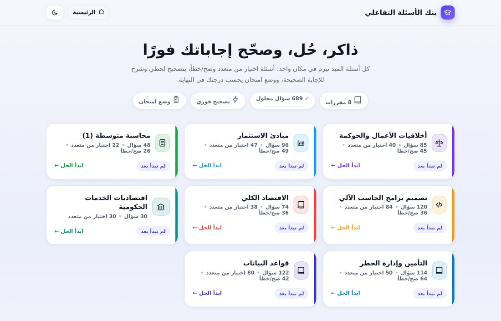
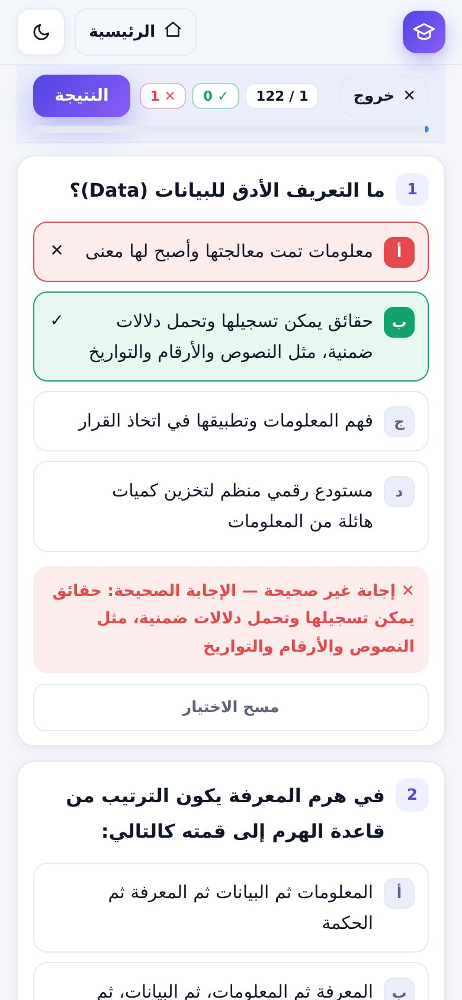

# بنك الأسئلة التفاعلي — ميد تيرم 🎓

موقع تفاعلي كامل في **ملف واحد** لحل بنوك أسئلة الميد تيرم وتصحيحها فورًا:
**8 مقررات · 709 أسئلة · تصحيح فوري وشرح · وضع تدريب ووضع امتحان**.

> صُنع وطُوِّر بواسطة **medo king** — [واتساب 0127 739 8832](https://wa.me/201277398832)

> 🗺️ **خطة التطوير القادمة:** انظر [`ROADMAP.md`](../ROADMAP.md) — مراحل التطوير، الأولويات، ومعايير الجودة قبل دمج أي تغيير.

<p align="center">
  
</p>

<p align="center">
  
  
  
</p>


---

## ✨ المميزات

| | الميزة |
|---|---|
| ⚡ | **تصحيح فوري** — تختار الإجابة فتعرف الصحيح فورًا مع سبب الإجابة (ملاحظات وشرح من ملف المقرر). |
| 🎯 | **وضع التدريب** — تصحيح لحظي لكل سؤال، تقدر تعيد أي سؤال براحتك. |
| 🧪 | **وضع الامتحان** — تجيب كل الأسئلة الأول، وفي النهاية درجة + مراجعة الأخطاء فقط. |
| 🔁 | **«أعد المحاولة»** لكل الأسئلة أو **للأسئلة الغلط بس**. |
| 🧠 | **مراجعة ذكية (Spaced Repetition)** — كل سؤال له مستوى إتقان من 0 إلى 5، والمراجعة القادمة تُحسب من المستوى: فورًا بعد الخطأ، يوم، 3 أيام، أسبوع، أسبوعان، 4 أسابيع. الخطأ يُنزل السؤال للمستوى 0 فورًا، وإظهار الإجابة لا يُحتسب إتقانًا. **المستوى 5 لا يعني الخروج من المراجعة** — يرجع كل 28 يومًا لتثبيت المعلومة. |
| 📈 | **تحليلات الأداء** — نسبة إجاباتك الصحيحة، رسم بياني لآخر 14 يوم، توزيع الإجابات، والأداء لكل مقرر وقسم. |
| 🎯 | **نقاط الضعف** — أضعف وأقوى الأقسام مرتّبة بالدقة (بحد أدنى 3 محاولات)، وقائمة بالأسئلة التي تكرر فيها الخطأ، وزر للتدرب على أضعف 5 أقسام. |
| 🔍 | **بحث داخل المقرر** — وأنت جوه أي مقرر، ابحث في أسئلته وشروحه وخياراته. غير حسّاس للتشكيل أو الهمزات (أ/ا/إ)، وتقدر تبدأ تدريبًا من النتائج مباشرة. **البحث مقصور على المقرر الحالي — لا يبحث في كل المقررات.** |
| 🗂️ | **سجل محاولات كامل** — كل إجابة تحلها محفوظة بتاريخها في `localStorage` (مستقل عن سجل الأخطاء)، مع سجل لكل جلسة حل. |
| 🎯 | **اختبار مخصص** — تحديد عدد الأسئلة من مجموعة المقرر المختارة، مع سحب عينة عشوائية عند تحديد عدد أقل من المتاح. |
| ⏱️ | **مؤقت اختياري** — تحديد مدة الامتحان بالدقائق مع تسليم تلقائي عند انتهاء الوقت، واستكمال الوقت المتبقي بعد إعادة فتح الجلسة. |
| 📊 | درجة لكل مقرر على الصفحة الرئيسية، وحفظ تلقائي لأفضل نتيجة وتقدّمك في المتصفح. |
| 🎨 | **الوضع الليلي/النهاري** + اختيار الأقسام + ترتيب عشوائي للأسئلة والخيارات. |
| 📱 | تجربة موبايل مُتقنة (320px → تابلت → ديسكتوب) بدون تمرير أفقي. |
| ⌨️ | اختصارات كيبورد: `1–5` للاختيار، الأسهم للتنقل، `Enter` للتأكيد/التالي. |
| 🖼️ | الأشكال والجداول المرفقة بالأسئلة بتكبير (Lightbox) بضغطة. |
| 📲 | **يعمل دون اتصال + يُثبَّت كتطبيق** — بعد أول زيارة تحفظ النسخة على جهازك، تقدر تفتحه بدون نت وتضيفه للشاشة الرئيسية (PWA). عند وجود تحديث يظهر زر «تحديث» بدل ما تفضل على نسخة قديمة. |
| 🔒 | **بدون سيرفر ولا حساب** — كل حاجة محليًا في المتصفح (`localStorage`)، مفيش أي بيانات بتترفع. |

## 📚 المقررات والأعداد

| المقرر | اختيار من متعدد | صح / خطأ | الإجمالي | الأقسام |
|---|---:|---:|---:|---:|
| أخلاقيات الأعمال والحوكمة | 40 | 45 | **85** | 2 |
| مبادئ الاستثمار | 47 | 49 | **96** | 2 |
| محاسبة متوسطة (1) | 22 | 26 | **48** | 2 |
| تصميم برامج الحاسب الآلي | 84 | 36 | **120** | 2 |
| الاقتصاد الكلي | 38 | 36 | **74** | 2 |
| اقتصاديات الخدمات الحكومية | 30 | 20 | **50** | 2 |
| التأمين وإدارة الخطر | 50 | 64 | **114** | 10 |
| قواعد البيانات | 80 | 42 | **122** | 10 |
| **الإجمالي** | **391** | **318** | **709** | **32** |

## 🚀 التشغيل

الموقع ملف HTML واحد مستقل (كل الأنماط والصور والأسئلة مدمجة جوّاه) — مش محتاج أي تثبيت:

```bash
# 1) افتحه مباشرة
open index.html          # macOS
start index.html         # Windows
xdg-open index.html      # Linux

# أو 2) شغّله على سيرفر محلي
python3 -m http.server 8000
# ثم افتح http://localhost:8000
```

## 🌐 النشر على GitHub Pages

الريبو مجهّز للنشر بضغطة:

1. اعمل رفع للريبو (انظر [الرفع لأول مرة](#-الرفع-لأول-مرة)).
2. من صفحة الريبو: **Settings → Pages → Source: GitHub Actions**.
3. أي `push` على `main` بيشغّل الـ workflow الجاهز في `.github/workflows/pages.yml` وينشر الموقع تلقائيًا على:
   `https://<USERNAME>.github.io/<REPO>/`

> بديل أسرع بدون Actions: **Settings → Pages → Source: Deploy from a branch → Branch: `main` / `root`** — الموقع `index.html` في جذر الريبو فهيشتغل على طول.

> **مهم لـ PWA:** لو نشرت بالطريقة اليدوية دي، لازم تكون `manifest.json` و`sw.js` في **جذر الموقع** (هما كذلك أصلًا بعد `build_site.py`). الـ service worker بيتحكم في الصفحات اللي تحت مساره بس، فمينفعش يبقى جوه `src/`.

## 📲 العمل دون اتصال (PWA)

بعد أول زيارة، الموقع يحفظ نفسه على جهازك ويشتغل بدون إنترنت:

| الحاجة | التفاصيل |
|---|---|
| **التثبيت** | من Chrome/Edge: أيقونة التثبيت في شريط العنوان. من Safari على iOS: «مشاركة → إضافة إلى الشاشة الرئيسية». |
| **الصفحة** | `manifest.json` في جذر الموقع، عربي و`dir: rtl`، بأيقونات 192 و512 ونسخة `maskable`. |
| **التخزين** | `sw.js` يحفظ نسخة من `index.html` والأيقونات والصورة الشخصية (≈757 KB إجمالًا). **فشل حفظ `index.html` يُفشل التثبيت بالكامل** — لا وعد بعمل دون اتصال لا يمكن الوفاء به؛ أما الأيقونات والصور فاختيارية. الكتابة إلى الكاش **تُنتظَر** قبل إنهاء الطلب، وأي استجابة بلا `Content-Type` لا تُحفظ (لا يمكن التحقق منها). |
| **فتح الصفحة** | **الشبكة أولًا** ثم النسخة المحفوظة — يعني اللي فاتح النت دايمًا بيشوف أحدث نسخة، واللي قافل النت بيلاقي آخر نسخة حفظها. **الصفحة لا تُحفظ إلا لو الاستجابة ناجحة و HTML** — صفحة خطأ 404 ما تمسحش النسخة الصالحة. |
| **التحديث** | لو فيه نسخة أحدث، يظهر زر «تحديث» أسفل الشاشة بدل ما تفضل على نسخة قديمة للأبد. |
| **اسم الكاش** | مشتق من بصمة محتوى البناء (`sw.js` مبني بـ hash)، فأي تعديل في الأسئلة ينتج كاش جديد ويُحذف القديم تلقائيًا. |
| **بدون نت لأول مرة** | لو الكاش فاضي والجهاز غير متصل، تظهر رسالة عربية واضحة بدل شاشة بيضاء. |

**الصورة الشخصية:** أصلها 946 KB لعرض 360px بس. بقت تُقدَّم بصيغة WebP (43 KB) مع PNG محسّن كاحتياطي (120 KB) عبر `<picture>` — حمولة التثبيت نزلت من **1519 KB إلى 757 KB**.

## 📁 هيكل المشروع

```
.
├── index.html                  # ✅ الموقع النهائي (ملف واحد جاهز للنشر — مولَّد)
├── manifest.json               # بيان تطبيق الويب (مولَّد من src/pwa/)
├── sw.js                       # service worker للعمل دون اتصال (مولَّد من src/pwa/)
├── src/
│   ├── app_template.html       # قالب الموقع (HTML + CSS + JS) فيه __DATA__ و__FIGS__
│   ├── data.json               # كل الأسئلة والإجابات (المصدر اللي بتتعدّل منه)
│   ├── figures/                # الأشكال والجداول المدمجة في الأسئلة
│   └── pwa/                    # أيقونات التطبيق + مصدر المانيفست والـ service worker
├── scripts/
│   ├── build_site.py           # يبني index.html من src/ (بدون أي اعتماديات)
│   └── extract/
│       ├── audit.py            # فحص جودة البيانات (20 نوع مشكلة، --strict)
│       └── ...                 # أدوات استخراج تاريخية (لا تعمل حاليًا — انظر ROADMAP)
├── tests/                      # اختبارات سلوكية للموقع المبني (jsdom)
├── docs/
│   ├── screenshots/            # صور للـ README
│   ├── phase-1-report.md       # تقرير المرحلة الأولى
│   ├── phase-2-report.md       # تقرير المرحلة الثانية
│   ├── phase-3-report.md       # تقرير المرحلة الثالثة (المراجعة الذكية)
│   └── phase-4-report.md       # تقرير المرحلة الرابعة (العمل دون اتصال / PWA)
├── package.json                # أدوات الاختبار فقط (jsdom) — الموقع نفسه بلا اعتماديات
├── .github/workflows/
│   ├── pages.yml               # نشر تلقائي على GitHub Pages
│   └── validate.yml            # فحص البيانات + البناء + 158 اختبارًا + فحص طفرات
└── LICENSE                     # MIT
```

## 🔧 إعادة البناء بعد أي تعديل

عدّل `src/data.json` أو `src/app_template.html` ثم:

```bash
python3 scripts/build_site.py            # يكتب index.html (≈571 KB) + manifest.json + sw.js
python3 scripts/extract/audit.py         # فحص البيانات: لازم ينتهي بـ OK
python3 scripts/extract/audit.py --strict # نفس الفحص + التحذيرات كأخطاء

npm install --no-save jsdom              # مرة واحدة (أداة اختبار فقط)
node tests/run.mjs                       # 171 اختبارًا سلوكيًا — لازم PASS
```

> **متطلب الاختبارات:** Node **22.22.2 أو أحدث** — `jsdom 31` يعتمد على واجهة `zstd` المضافة في Node 22.7. الموقع نفسه لا يحتاج Node إطلاقًا؛ القيد على أداة الاختبار فقط، والمشغّل يعطي رسالة واضحة لو الإصدار أقدم.
>
> **مهم:** `index.html` مولَّد ومرفوع مع المصدر. أي تعديل على `src/` يجب أن يتبعه `build_site.py` وإلا سيفشل الـ CI (`git diff --exit-code`).

### الاختبارات

`tests/` تحمّل `index.html` المبني فعلًا داخل `jsdom` وتستخدمه كما يستخدمه الطالب — نقر فعلي على الخيارات وتبديل الوضع وانتظار انتهاء المؤقت:

| الملف | التغطية |
|---|---|
| `tests/data.test.mjs` | سلامة البنك + هجمات XSS على كل مسار عرض |
| `tests/quiz.test.mjs` | التدريب، الامتحان، المؤقت، الجلسة، سجل الأخطاء |
| `tests/a11y.test.mjs` | دلالات ARIA واختصارات الكيبورد |
| `tests/history.test.mjs` | سجل المحاولات والجلسات والتحليلات |
| `tests/search.test.mjs` | البحث داخل المقرر ونطاقه ومعالجة العربية |
| `tests/pwa.test.mjs` | المانيفست والأيقونات، تشغيل الـ service worker فعليًا (تخزين/تفعيل/عمل دون اتصال)، وبانر «غير متصل» |

الـ CI يشغّل وظيفة `mutants` تكسر الموقع عمدًا (تعطيل `esc()` وتعطيل المؤقت) وتتوقع فشل الاختبارات — الضمانة أن الحزمة لا تصبح شكلية مع الوقت.

`jsdom` أداة اختبار فقط. **بناء الموقع ونشره يحتاجان `python3` وحدهما** — لا npm ولا pip.

### مفاتيح التخزين في المتصفح

| المفتاح | المحتوى | ملاحظة |
|---|---|---|
| `qb.best` | أفضل نسبة لكل مقرر | رقم واحد لكل مقرر |
| `qb.mastery.v1` | مستوى إتقان كل سؤال | **نظام المراجعة الذكية** — 6 مستويات، يقرر موعد المراجعة القادمة |
| `qb.review.v1` | (قديم) أسئلة تحتاج مراجعة | يُرحَّل تلقائيًا إلى `qb.mastery.v1` عند أول تحميل، ويبقى للتوافق |
| `qb.history.v1` | سجل كل المحاولات والجلسات | مستقل تمامًا — مصدر التحليلات، محدود بـ 5000 محاولة / 400 يوم |
| `qb.session` | الجلسة الجارية | تُحذف عند الخروج أو الإكمال |
| `qb.examSettings` | إعدادات الامتحان | العدد والمؤقت |
| `qb.theme` | المظهر | `light` / `dark` |

> **مهم:** نظامان منفصلان بالقصد. `qb.mastery.v1` يجيب «ماذا أراجع الآن؟» (حالة حالية لكل سؤال)، و`qb.history.v1` يجيب «ماذا فعلت؟» (سجل زمني كامل). لا تدمجهما — راجع `ROADMAP.md` §3.3.

### سلّم المراجعة الذكية

| المستوى | المعنى | المراجعة القادمة |
|---|---|---|
| 0 | أخطأ للتو | فورًا |
| 1 | صحيح مرة | يوم |
| 2 | صحيح مرتين | 3 أيام |
| 3 | متقن جزئيًا | أسبوع |
| 4 | متقن | أسبوعان |
| 5 | مستقر | 4 أسابيع (يرجع للمراجعة) |

الفجوة القصوى 28 يومًا — لا يُصان سؤال أكثر من ذلك على أساس أداء قديم. المستوى 5 يعني «مستقر» لا «منتهٍ»: السؤال يظل في الجدول ويعود كل 28 يومًا، ولا يخرج من القائمة إلا إذا اختفى من بنك الأسئلة.

### صيغة السؤال في `src/data.json`

```jsonc
[
  {
    "id": "ethics",
    "title": "أخلاقيات الأعمال والحوكمة",
    "emoji": "⚖️",
    "color": "#7c3aed",
    "sections": [
      {
        "id": "eth-mcq-1",
        "title": "الاختيار من متعدد",
        "type": "mcq",                       // "mcq" أو "tf"
        "questions": [
          {
            "id": "ethics-mcq-<stable-hash>", // معرّف ثابت يولّده سكربت الاستخراج
            "q": "نص السؤال؟",
            "options": ["أ", "ب", "ج", "د"],
            "ans": 0,                        // فهرس الإجابة الصحيحة (يبدأ من 0)
            "fig": "1",                      // اختياري: مفتاح شكل من src/figures
            "note": "شرح/ملاحظة تظهر بعد الإجابة"   // اختياري
          }
        ]
      },
      { "id": "eth-tf-1", "title": "صح / خطأ", "type": "tf",
        "questions": [ { "q": "العبارة…", "ans": true } ] }   // true / false
    ]
  }
]
```

## 🧩 استخراج الأسئلة من PDF (اختياري)

السكربتات في `scripts/extract/` هي اللي بنت `src/data.json` من ملفات الـ PDF الأصلية
(استخراج على مستوى الحروف مع إصلاحات نصية وإجابة نموذجية لكل سؤال):

```bash
pip install pymupdf
mkdir -p pdfs && cp your-banks/*.pdf pdfs/     # ملفات الـ PDF مش مرفوعة في الريبو
python3 scripts/extract/make_data.py           # يكتب src/data.json
python3 scripts/build_site.py
```

> ملفات الـ PDF الأصلية **غير مضمّنة** في الريبو (حقوق مواد المقررات) — الريبو بيشمل الناتج النهائي `src/data.json`.

## 🗂️ الرفع لأول مرة

```bash
git init
git add .
git commit -m "feat: بنك الأسئلة التفاعلي — 8 مقررات و709 أسئلة"
git branch -M main
git remote add origin https://github.com/<USERNAME>/<REPO>.git
git push -u origin main
```

## 📱 التوافق

مُختبَر على Chromium (ديسكتوب + محاكاة موبايل 320 / 360 / 375 / 390 / 414 / 768px، وضع ليلي، ووضع أفقي).
متصفحات حديثة: Chrome / Edge / Firefox / Safari (iOS 15+).

## 📄 الترخيص

كود الموقع تحت ترخيص [MIT](LICENSE). أما **محتوى الأسئلة** فمصدره ملفات المقررات ومسؤوليته على المستخدم.

---

<div align="center">

**صُنع وطُوِّر بواسطة [medo king](https://wa.me/201277398832)**
[📞 واتساب 0127 739 8832](https://wa.me/201277398832)

</div>
