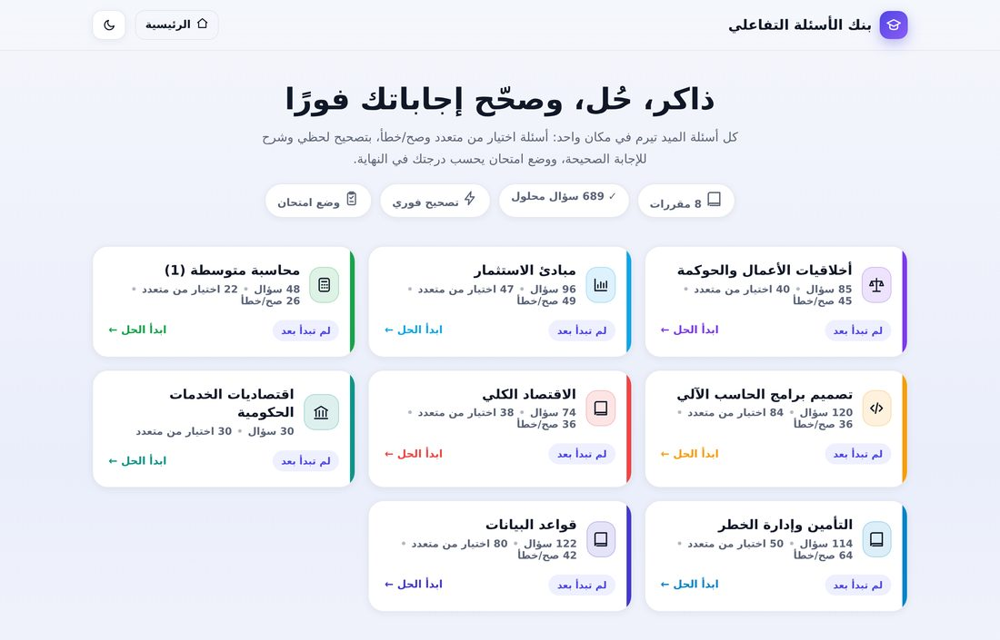
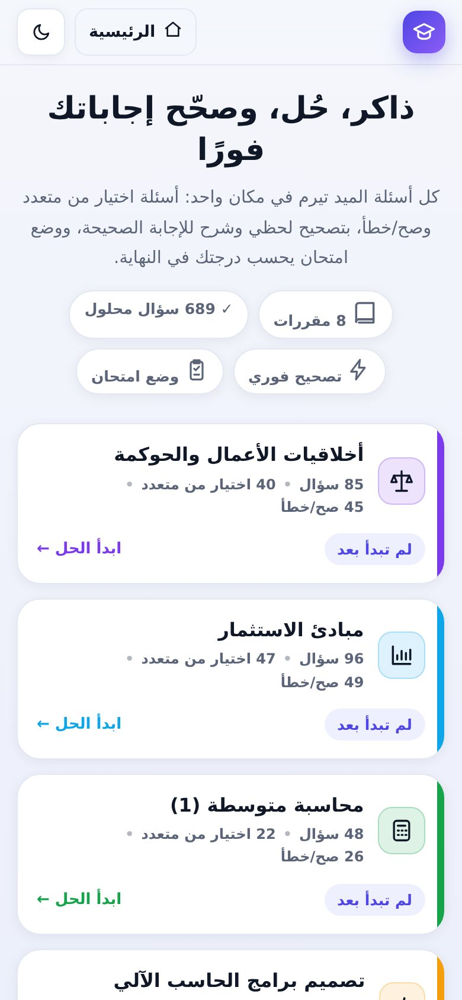
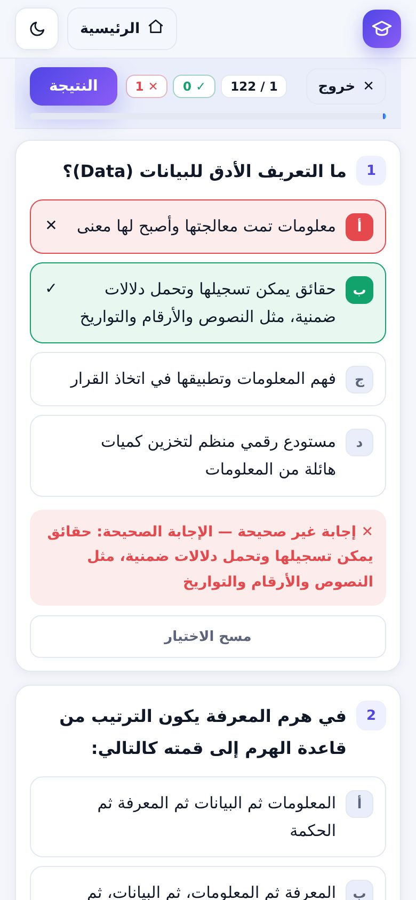
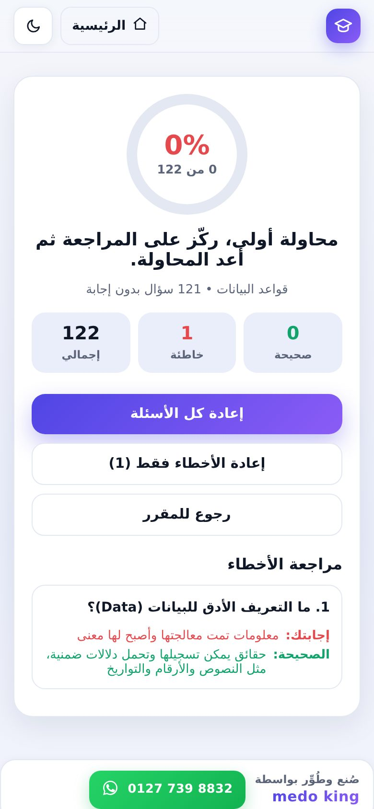

# بنك الأسئلة التفاعلي — ميد تيرم 🎓

موقع تفاعلي كامل في **ملف واحد** لحل بنوك أسئلة الميد تيرم وتصحيحها فورًا:
**8 مقررات · 709 أسئلة · تصحيح فوري وشرح · وضع تدريب ووضع امتحان**.

> صُنع وطُوِّر بواسطة **medo king** — [واتساب 0127 739 8832](https://wa.me/201277398832)

<p align="center">
  
</p>

<p align="center">
  
  
  
</p>


---

## ✨ المميزات

| | الميزة |
|---|---|
| ⚡ | **تصحيح فوري** — تختار الإجابة فتعرف الصحيح فورًا مع سبب الإجابة (ملاحظات وشرح من ملف المقرر). |
| 🎯 | **وضع التدريب** — تصحيح لحظي لكل سؤال، تقدر تعيد أي سؤال براحتك. |
| 🧪 | **وضع الامتحان** — تجيب كل الأسئلة الأول، وفي النهاية درجة + مراجعة الأخطاء فقط. |
| 🔁 | **«أعد المحاولة»** لكل الأسئلة أو **للأسئلة الغلط بس**. |
| 📊 | درجة لكل مقرر على الصفحة الرئيسية، وحفظ تلقائي لأفضل نتيجة وتقدّمك في المتصفح. |
| 🎨 | **الوضع الليلي/النهاري** + اختيار الأقسام + ترتيب عشوائي للأسئلة والخيارات. |
| 📱 | تجربة موبايل مُتقنة (320px → تابلت → ديسكتوب) بدون تمرير أفقي. |
| ⌨️ | اختصارات كيبورد: `1–5` للاختيار، الأسهم للتنقل، `Enter` للتأكيد/التالي. |
| 🖼️ | الأشكال والجداول المرفقة بالأسئلة بتكبير (Lightbox) بضغطة. |
| 🔒 | **بدون سيرفر ولا حساب** — كل حاجة محليًا في المتصفح (`localStorage`)، مفيش أي بيانات بتترفع. |

## 📚 المقررات والأعداد

| المقرر | اختيار من متعدد | صح / خطأ | الإجمالي | الأقسام |
|---|---:|---:|---:|---:|
| أخلاقيات الأعمال والحوكمة | 40 | 45 | **85** | 2 |
| مبادئ الاستثمار | 47 | 49 | **96** | 2 |
| محاسبة متوسطة (1) | 22 | 26 | **48** | 2 |
| تصميم برامج الحاسب الآلي | 84 | 36 | **120** | 2 |
| الاقتصاد الكلي | 38 | 36 | **74** | 2 |
| اقتصاديات الخدمات الحكومية | 30 | 20 | **50** | 2 |
| التأمين وإدارة الخطر | 50 | 64 | **114** | 10 |
| قواعد البيانات | 80 | 42 | **122** | 10 |
| **الإجمالي** | **391** | **318** | **709** | **32** |

## 🚀 التشغيل

الموقع ملف HTML واحد مستقل (كل الأنماط والصور والأسئلة مدمجة جوّاه) — مش محتاج أي تثبيت:

```bash
# 1) افتحه مباشرة
open index.html          # macOS
start index.html         # Windows
xdg-open index.html      # Linux

# أو 2) شغّله على سيرفر محلي
python3 -m http.server 8000
# ثم افتح http://localhost:8000
```

## 🌐 النشر على GitHub Pages

الريبو مجهّز للنشر بضغطة:

1. اعمل رفع للريبو (انظر [الرفع لأول مرة](#-الرفع-لأول-مرة)).
2. من صفحة الريبو: **Settings → Pages → Source: GitHub Actions**.
3. أي `push` على `main` بيشغّل الـ workflow الجاهز في `.github/workflows/pages.yml` وينشر الموقع تلقائيًا على:
   `https://<USERNAME>.github.io/<REPO>/`

> بديل أسرع بدون Actions: **Settings → Pages → Source: Deploy from a branch → Branch: `main` / `root`** — الموقع `index.html` في جذر الريبو فهيشتغل على طول.

## 📁 هيكل المشروع

```
.
├── index.html                  # ✅ الموقع النهائي (ملف واحد جاهز للنشر — مولَّد)
├── src/
│   ├── app_template.html       # قالب الموقع (HTML + CSS + JS) فيه __DATA__ و__FIGS__
│   ├── data.json               # كل الأسئلة والإجابات (المصدر اللي بتتعدّل منه)
│   └── figures/                # الأشكال والجداول المدمجة في الأسئلة
├── scripts/
│   ├── build_site.py           # يبني index.html من src/ (بدون أي اعتماديات)
│   └── extract/                # أدوات استخراج الأسئلة من ملفات PDF الأصلية
├── docs/screenshots/           # صور للـ README
├── .github/workflows/pages.yml # نشر تلقائي على GitHub Pages
└── LICENSE                     # MIT
```

## 🔧 إعادة البناء بعد أي تعديل

عدّل `src/data.json` أو `src/app_template.html` ثم:

```bash
python3 scripts/build_site.py     # يكتب index.html (≈490 KB)
python3 scripts/extract/audit.py  # فحص سلامة البيانات: لازم ينتهي بـ OK
```

### صيغة السؤال في `src/data.json`

```jsonc
[
  {
    "id": "ethics",
    "title": "أخلاقيات الأعمال والحوكمة",
    "emoji": "⚖️",
    "color": "#7c3aed",
    "sections": [
      {
        "id": "eth-mcq-1",
        "title": "الاختيار من متعدد",
        "type": "mcq",                       // "mcq" أو "tf"
        "questions": [
          {
            "q": "نص السؤال؟",
            "options": ["أ", "ب", "ج", "د"],
            "ans": 0,                        // فهرس الإجابة الصحيحة (يبدأ من 0)
            "fig": "1",                      // اختياري: مفتاح شكل من src/figures
            "note": "شرح/ملاحظة تظهر بعد الإجابة"   // اختياري
          }
        ]
      },
      { "id": "eth-tf-1", "title": "صح / خطأ", "type": "tf",
        "questions": [ { "q": "العبارة…", "ans": true } ] }   // true / false
    ]
  }
]
```

## 🧩 استخراج الأسئلة من PDF (اختياري)

السكربتات في `scripts/extract/` هي اللي بنت `src/data.json` من ملفات الـ PDF الأصلية
(استخراج على مستوى الحروف مع إصلاحات نصية وإجابة نموذجية لكل سؤال):

```bash
pip install pymupdf
mkdir -p pdfs && cp your-banks/*.pdf pdfs/     # ملفات الـ PDF مش مرفوعة في الريبو
python3 scripts/extract/make_data.py           # يكتب src/data.json
python3 scripts/build_site.py
```

> ملفات الـ PDF الأصلية **غير مضمّنة** في الريبو (حقوق مواد المقررات) — الريبو بيشمل الناتج النهائي `src/data.json`.

## 🗂️ الرفع لأول مرة

```bash
git init
git add .
git commit -m "feat: بنك الأسئلة التفاعلي — 8 مقررات و709 أسئلة"
git branch -M main
git remote add origin https://github.com/<USERNAME>/<REPO>.git
git push -u origin main
```

## 📱 التوافق

مُختبَر على Chromium (ديسكتوب + محاكاة موبايل 320 / 360 / 375 / 390 / 414 / 768px، وضع ليلي، ووضع أفقي).
متصفحات حديثة: Chrome / Edge / Firefox / Safari (iOS 15+).

## 📄 الترخيص

كود الموقع تحت ترخيص [MIT](LICENSE). أما **محتوى الأسئلة** فمصدره ملفات المقررات ومسؤوليته على المستخدم.

---

<div align="center">

**صُنع وطُوِّر بواسطة [medo king](https://wa.me/201277398832)**
[📞 واتساب 0127 739 8832](https://wa.me/201277398832)

</div>
